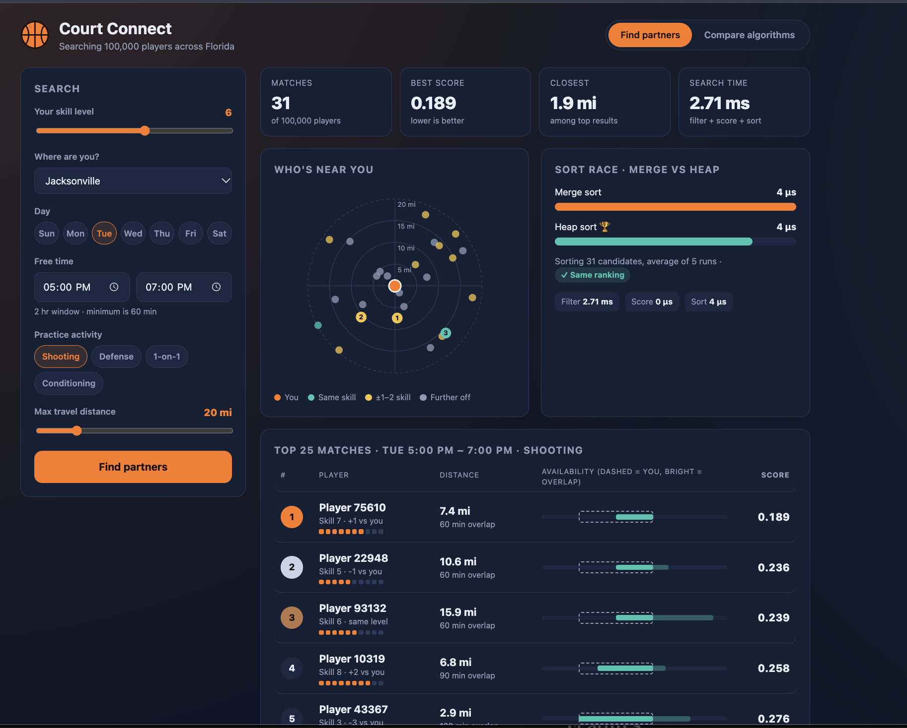

# 🏀 Court Connect

**Find a basketball practice partner near you.**

Court Connect matches basketball players across Florida by skill level, location, schedule and practice activity. It searches 100,000 player profiles, ranks the best matches, and compares two sorting algorithms (**merge sort** and **heap sort**) on the same data.

You can use it from the terminal or through a web page in your browser.



---

## Table of Contents
- [Features](#features)
- [How Matching Works](#how-matching-works)
- [Requirements](#requirements)
- [Build](#build)
- [Run the Terminal App](#run-the-terminal-app)
- [Run the Web Demo](#run-the-web-demo)
- [Share the Demo Publicly](#share-the-demo-publicly)
- [Run the Tests](#run-the-tests)
- [Project Structure](#project-structure)
- [Team](#team)
- [Credits](#credits)

---

## Features
- **Partner search** by skill level (1–10), city or coordinates, day of the week, free time window, practice activity and max travel distance
- **Ranked results**, best match first, with distance and how many minutes your schedules overlap
- **Algorithm comparison**: times merge sort vs heap sort and checks that both give the same ranking
- **Full benchmark**: 1,000 up to 100,000 players in four input orders (random, already sorted, reverse sorted, all tied)
- **Web demo** with a map-style "who's near you" plot, a sort race, availability timelines and benchmark charts
- **Friendly input checks**: a time window must be at least 60 minutes long and end after it starts (typing `5:00 PM` then `7:00` is read as 7:00 PM)

---

## How Matching Works

**1. Filter.** A player is kept only if they:
- practice on the **same day**
- want the **same practice activity**
- overlap your free time by **at least 60 minutes**
- are within your **max travel distance** (great-circle distance using the haversine formula)

**2. Score.** Each remaining player gets a score, and **lower is better**:

```
score = 0.70 × (skill difference ÷ 9) + 0.30 × (distance ÷ your max distance)
```

**3. Sort.** Candidates are sorted by score, with ties broken by player ID, using **merge sort**. **Heap sort** runs on the same list so the two can be timed and checked against each other.

---

## Requirements
- A C++17 compiler (`clang++` on Mac, `g++` on Linux, or MSVC on Windows)
- [CMake](https://cmake.org/) 3.16 or newer

On a Mac:
```
xcode-select --install
brew install cmake
```

---

## Build
From the `Court-Connect` folder:
```
cmake -S . -B build
cmake --build build
```

Then generate the player data. This only needs to happen once:
```
mkdir -p data
./build/generate_players
```
This writes 100,000 players to `data/players.csv`. It uses a fixed random seed, so everyone gets the same players.

---

## Run the Terminal App
```
./build/court_connect
```
Pick **1) Find partners** to search, or **2) Compare algorithms** to time merge sort against heap sort.

You can also point it at a different file: `./build/court_connect path/to/players.csv`

---

## Run the Web Demo
```
./build/court_connect_web
```
Then open **http://localhost:8080** in your browser. Press `Ctrl+C` in the terminal to stop it.

- Run it from the `Court-Connect` folder so it can find `web/` and `data/players.csv`.
- To use a different file or port: `./build/court_connect_web data/players.csv 9000`

The web page uses the same C++ filter, scoring and sorting code as the terminal app. The browser only shows the results.

| Endpoint | What it returns |
|-|-|
| `GET /api/meta` | Player count, city list and practice types |
| `GET /api/search?skill=5&lat=29.65&lon=-82.32&day=1&start=17:00&end=19:00&practice=shooting&dist=20` | Top 25 matches and timing for each step |
| `GET /api/benchmark` | Full merge sort vs heap sort benchmark |

---

## Share the Demo Publicly
To give others a link while the web demo runs on your computer, use a free Cloudflare quick tunnel. No account is needed.

```
brew install cloudflared
```
With `court_connect_web` running, open a second terminal and run:
```
cloudflared tunnel --url http://localhost:8080
```
It prints a public `https://....trycloudflare.com` link. The link works only while both programs are running and your computer is awake, and you get a new link each time.

---

## Run the Tests
```
./build/court_connect_tests
```
You should see `All tests passed.`

---

## Project Structure
```
Court-Connect/
├── CMakeLists.txt            build setup
├── include/
│   └── court_connect.h       shared types (Player, SearchQuery, Candidate) and function names
├── src/
│   ├── main.cpp              terminal app entry point
│   ├── menu.cpp / menu.h     terminal screens (search form, results, comparison)
│   ├── input.cpp / input.h   reading and checking numbers and times
│   ├── data_loader.cpp       loads players.csv
│   ├── geo.cpp               haversine distance in miles
│   ├── filter.cpp            filtering and scoring
│   ├── merge_sort.cpp        merge sort
│   ├── heap_sort.cpp         heap sort
│   ├── timing.cpp / timing.h timing and comparing the two sorts
│   └── web_main.cpp          web server for the browser demo
├── web/
│   └── index.html            web page (HTML, CSS and JavaScript)
├── third_party/
│   └── httplib.h             cpp-httplib web server library
├── tools/
│   └── generate_players.cpp  makes the 100,000 test players
├── tests/
│   └── test_main.cpp         unit tests
└── data/                     players.csv goes here (not in git)
```

---

## Team
| Member | Files |
|-|-|
| **Zachary Martus** | `main.cpp`, `menu.cpp/.h`, `input.cpp/.h`, `timing.cpp/.h` |
| **Zachery Lowry** | `geo.cpp`, `filter.cpp`, `heap_sort.cpp` |
| **Shrish Arun** | `data_loader.cpp`, `merge_sort.cpp`, `tools/generate_players.cpp` |

---

## Credits
- **[cpp-httplib](https://github.com/yhirose/cpp-httplib)** by yhirose (MIT license), used for the web server. Its license is included at the top of `third_party/httplib.h`.
- [JSON format](https://www.json.org/json-en.html), used for the web server's responses
- [cppreference](https://en.cppreference.com), the C++ standard library reference
- [MDN Web Docs](https://developer.mozilla.org), the HTML, CSS and JavaScript reference
- [Cloudflare Quick Tunnels](https://developers.cloudflare.com/tunnel/get-started/quick-tunnels/), used for sharing the demo
- Web demo (`web_main.cpp`, `web/index.html`) built with help https://github.com/yhirose/cpp-httplib 
